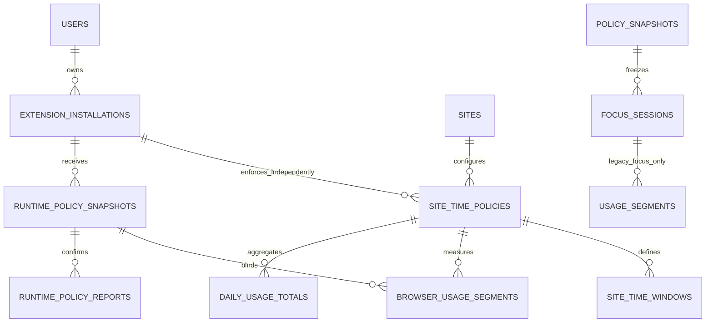
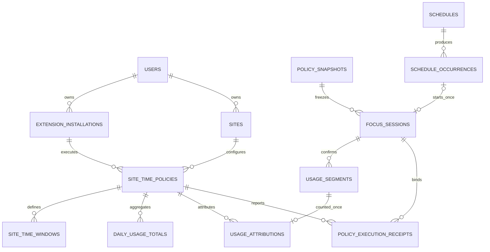

# 공통 계약 차이표와 변경 초안

## 현행 3차 계약 — 사용자 확정 정책 반영

정책 서명: `tracking_scope=BROWSER_ALWAYS; budget_scope=INSTALLATION; day_boundary=USER_TIMEZONE; limit_effect=SITE_ONLY; allow_bypass=false`.

추가 확정: `timezone_change=AFTER_CURRENT_DAY_CARRY; guest_import=COMPLETED_ANALYTICS_ONLY`. DEC-06·DEC-07은 사용자 확정이며 FIN-01·02의 정책승인 대기를 해소한다. 회원전환 전후 같은설치의 원장 연속성은 별도 기술합의이고 자동가져오기·회원 현재한도 자동합산은 금지한다.

DEC-01 상시 측정·집행, DEC-02 설치별 한도/회원합계 조회전용, DEC-03 사용자시간대 자정, DEC-04 해당사이트만 차단/집중유지, DEC-05 예약·시간대·한도·전역제한은 사이트 ALLOW보다 우선은 사용자 확정이다. 아래 신규 wire/API/DDL은 이 정책을 구현하기 위한 **공동 검토 대상 계약안**이며 제품 구현·기존R3 발급 활성화 승인이 아니다. 직전 FOCUS_ONLY안은 뒤의 보관구역으로 이동했다. 기존 Event1.2·Snapshot1.1/1.2·Journal1.1·D01~D10·APPLY_POLICY는 변경하지 않는다.

### A3. 정책 수명주기·식별자·적용 시점

### DEC-06·07 확정 반영 — 시간대·가져오기 계약

DEC-06: `/user-timezone`은 desired timezone/version과현재applied timezone/version·current_day_end_at/effective_at을분리한다. effective_at은요청시점의현재사용자day 종료UTC이며, 같은날반복편집이effective_at을앞당기거나여러전환bucket을만들지못한다. current_day usage/과거원장·원래timezone/version은불변이다. 기존timezone day종료에새zone을적용하고그시점부터새zone의다음미래자정까지TRANSITION을만든다. 전환시잔여budget을승계하고전환시점에전액한도를추가하지않는다. 첫새zone자정부터정상day집계를시작한다. 02 E3의전환설명은이확정규칙을따른다.

DB검토안: `timezone_change_id` UUID와desired/applied version·effective_at, `daily_usage_totals.day_kind` NORMAL/TRANSITION·`budget_carry_ms`·`transition_source_day_start_at`을결속한다. UQ(executor_id,policy_id,timezone_change_id)는같은전환재생성방지, day_start_at은UTC원본키다. carry는집행계산용이지실제사용시간이아니다. limit30분/기존확인20분이면전환초기잔여10분, 전환구간5분사용뒤잔여5분, 실제누적은25분이며carry를더해45분으로집계하지않는다. 한도변경과timezone변경경합은직렬화해기존spent를보존하고과거usage재분류/reset하지않는다. clock역행/재시작/같은요청replay는같은change/day결과를반환한다. 세부commit경계·복구receipt는D06/Wire 공동기술검토다.

DEC-07: 신규import 후보 item type `BROWSER_USAGE_RECORD`는사용자가선택한guest완료기록에만허용한다. `record_state=COMPLETED`, `completed_at`, `source_record_id`, `source_installation_id`, `source_hash`와최종segment manifest를검증한다. 개별segment의closed=true와기록전체완료는다르므로checkpoint만닫히고record가OPEN인자료는제외한다. lifecycle COMPLETED와quality COMPLETE/PARTIAL도분리, 완료기록이부분측정이면확인시간만반영하고quality를보존한다. 로그인/연결/배치조회만으로업로드하지않는다.

기존 `/guest-imports` manifest/item/status의인증·선택·부분실패·SOURCE_BOUND_TO_OTHER_ACCOUNT/내용충돌원칙을재사용하되신규item exactschema/capability는공동승인전미지원으로거절한다. item request 후보는 `{type,source_record_id,source_installation_id,source_hash,record_state,completed_at,segments}`이며회원owner는bearer에서결정한다. 성공response는 `{item_id,result,analytics_applied:true,enforcement_applied:false,source_preserved:true}`의미, 실제로서버/로컬확인후만성공확정한다. 원문다른동일source/id는409 SOURCE_CONFLICT, 미완료기록422 RECORD_NOT_COMPLETED, 타회원귀속409 SOURCE_BOUND_TO_OTHER_ACCOUNT 후보, 기존미지원은 IMPORT_TYPE_UNSUPPORTED 유지. 정확코드/필드명은Wire검토대상이다.

새연결테이블후보 `browser_usage_import_links`는 UQ(source_installation_id,source_record_id)·source_hash·bound_user_id·original_owner_context·analytics_projection_id·import_item_id·status를갖는다. hash는식별키가아니라같은ID의다른내용충돌검사다. import상세/통계projection원자저장후ACK, 응답유실시status조회·같은원문재전송, 재선택/재시작/배치변경으로중복가산0. guest원본삭제/owner덮어쓰기/seq재발행0, 진행중import를보관정리로유실하지않는다. 원장조회는원소유자와회원분석귀속을별도관계로유지한다.

회원분석은 `analytics_source=GUEST_IMPORT`와imported_confirmed_ms/원quality·원timezone을표시하고선택완료기록을포함한다. 현재policy usage/remaining/한도도달집행query는 `enforcement_source=MEMBER_RUNTIME`만사용하며imported_confirmed_ms를합산하지않는다. 동일설치라는이유만으로guest당일사용량을member currentday에carry하지않는다. 통계기간변경/중복import가quota를변경하는반례를거절한다.

같은설치회원전환기술안: 이전guest의현재구간을마지막확인시각에서close·durable저장하고이전owner의ACK/outbox/원문을유지한다. 같은executor의검증된소유전환fence에서이전runtime의자기규칙해제/잔존의무를확인한뒤member policy와이미존재하는member당일원장을복원한다. 전환을사용량reset명령으로쓰거나active구간을두owner에중복계수하지않는다. 이전epoch/seq와새owner stream의교차관계·서버설치증명재결속은기술검토대상이며, guest→member 원장자동병합/신규quota초기화로해결하지않는다. 실패/UNKNOWN은원문보존·대상보류/복구안내, focus로그아웃/정상END기존순서를우회하지않는다.

Event/Snapshot 영향: timezone change/import는runtime/새import stream의변경이며 Event1.2 접근사유·반복정의·focus Snapshot1.1/1.2·Journal1.1·APPLY_POLICY duration/revision을변경하지않는다. 가져온자료에새event_id/가짜focus session을만들지않는다. time change 보고는change_id/condition instance로멱등, import결과는import item결과이지접근event아니다. 구R3는새item/runtime미지원으로명시거절하고구완료세션import·조회/정상END는보존한다.

최종 기술 선택은05의 FIN-01~05가 원본이다. 직전 E3 timezone전환안은 FIN-01의잔여budget승계안으로보완하되 **DEC-06 확정정책의 기술 구현안**다. 전환구간을새정상day처럼전액초기화하지않는다. 구현안은 daily_usage_totals에 `budget_carry_ms`(집행전용·기본0), `day_kind` NORMAL/TRANSITION을추가하고 remaining=max(0,daily_limit_ms-budget_carry_ms-confirmed_ms)로계산한다. budget_carry_ms는사용량이아니므로원장/계정합계/일별사용시간에가산0, 과거원장재작성0. 현재날짜가종료되기전에timezone을적용하거나한도를다시주는UI는금지한다.

FIN-02는DEC-07로확정되었다. 명시선택한완료기록만분석용으로가져온다. imported 상시기록은 member분석projection에 source귀속으로연결하고현day enforcement원장에몰래복사하지않는다. 실제같은설치의guest→member여부는인증·source증명검증으로결정, installation ID문자열일치만으로carry권한을주지않는다. 취소/실패는guest원문보존, 성공/중복의원문hash와member귀속관계를보존한다. source uniqueness는기존source item의내용충돌을탐지하도록(source_installation_id,source_item_id)를식별키로하고source_hash는다른내용거절검사에사용한다. dedup키를세컬럼으로두어다른hash를새성공행으로허용하면안된다.

FIN-04/05는새로운D06최종승인문서를병렬생성하지않고기존Core/Content의U-01~08협의사항과이runtime확장을한공동contract revision에결속한다. 정확version/전체필드·sender조건·cleanup상한·실제증거필드를세담당이서명하기전 D06_FINAL/READY로표시하지않는다. 서버ACCEPTED·proof_digest형식확인만으로실제Chrome효과를증명하지않는기준을유지한다.

| 정책 | 수명·적용 계약 | 해제 소유권 |
|---|---|---|
| 집중 세션 | 기존 session_id/frozen Snapshot·desired_revision. 설정 변경은 다음 집중세션부터 적용. START/PAUSE/RESUME/END 실제확인 규칙 유지 | END/PAUSE는 해당 session binding만 해제. duration_minutes=1..180 root·RELEASE에는 기간필수화 없음 |
| 상시 예약 BLOCK | 설치별 runtime policy의 ONCE/WEEKLY window로 실행, 세션 없음/PAUSED/ENDED에서도 유지 | 해당window 만료/정책교체/상시정책 OFF의 실제확인. 집중 END는 해제사유가 아님 |
| 이용 가능 시간대 | 설치별 runtime policy의 허용창을 평가. ALLOW_WINDOW union 밖이면 TIME_WINDOW 제한 | 허용창 진입 시 해당사유만 제거, 다른BLOCK 유지 |
| 일일 한도 | 해당 설치/owner/site범위의 상시원장·사용자timezone day bucket 기반, 세션/서버통신과 독립 | 새day에 DAILY_LIMIT 원인만 재평가·해제확인, 다른BLOCK 유지 |
| 사이트/성인/키워드·내부기능/블러 | 기존 집중세션 Snapshot 의미 유지. ‘전역’은 개별site ALLOW로 면제할 수 없는 활성global정책이라는 의미 | 성인/키워드를 세션 밖에도 확장할지는 TECH-04 미확정. 이번상시확정은 시간/예약정책이며 기존모든 Content 설정을 무단상시화하지 않음 |

상시 설정은 다음 집중세션을 기다리지 않는다. 저장→Server immutable runtime policy package 생성→Core 검증·durable pending→원자적 교체→실제 규칙/관측 확인→보고 후 APPLIED. UI는 saved_version과 applied_version을 구분한다. 네트워크 단절 시 현재 last-verified package 유지, 새설정은 PENDING_SYNC. 저장성공은 실제집행성공이 아니다. version교체가 활성 집중 Snapshot을 다시 쓰거나 session desired_revision을 증가시키지 않는다. 기본 제안은 정상 next collector boundary에서 반영하며 이미 닫힌 segment는 원래 version으로 귀속한다(TECH-03).

runtime 식별: `runtime_snapshot_id` UUID(불변패키지), `runtime_policy_revision` 양의 safe integer(Server/guest owner별), `runtime_execution_id` UUID(Core 설치내 활성binding), `collector_epoch` UUID(영속stream·Worker재생성마다 변경금지), `local_usage_seq` safe양수, `report_id`/`segment_id` UUID. `session_id`는 optional 관련문맥일 뿐 신규runtime 권한/FK/필수가 아니다. `owner_context`는 MEMBER+인증user/executor 또는 GUEST+로컬설치owner. client body의 회원ID를 신뢰하지 않는다. runtime과focus의 revision/Journal/ACK는 별개다. 기존 session.version 역사예외 number|string·version_increment_blocked 유지.

### B3. DB·ERD·원장

기존 usage_segments(session FK·확인RUN)는 집중통계용 원문으로 보존하고 **별도 browser_usage_segments**를 추가한다. 상시원장을 기존세션원장으로 강제생성하거나 fake session을 만들지 않는다. 겹치는 집중구간은 browser segment와 immutable attribution으로 연결, 동일기간을 두 원장에서 합산하지 않는다.

| 테이블/필드 후보 | 제약·인덱스·관계 |
|---|---|
| site_time_policies | policy_id UUID PK; user_id BIGINT FK; executor_id UUID FK; site_id BIGINT FK; policy_version safe>=1; tracking_scope=BROWSER_ALWAYS; enabled boolean; daily_limit_ms BIGINT nullable; timezone IANA; timezone_version safe; created_at/updated_at UTC. UQ(user_id,executor_id,site_id). FK 소유일치검사. enabled=false는설정보관, daily_limit_ms=null은한도조건OFF |
| site_time_windows | window_id UUID PK; policy_id FK; kind BLOCK_WINDOW/ALLOW_WINDOW; recurrence ONCE/WEEKLY; once_start/end UTC nullable; weekdays mask nullable; local_start/end HH:mm nullable; enabled. ONCE/WEEKLY 상호배타검증, index(policy_id,enabled). 기존 schedules는 집중예약만 담당 |
| runtime_policy_snapshots | runtime_snapshot_id UUID PK; user_id/executor_id; runtime_policy_revision safe; format_version RUNTIME_POLICY_1 후보; payload JSON; payload_hash hex64; created_at. UQ(user_id,executor_id,runtime_policy_revision). 원문불변, 현재포인터는별도 설치runtime state |
| browser_usage_segments | segment_id UUID PK; user_id/executor_id; collector_epoch UUID; local_usage_seq safe; runtime_snapshot_id FK; policy_id FK; policy_version safe; actual_host VARCHAR253; matched_policy_host VARCHAR253; day_start_at/day_end_at UTC; start_at/end_at UTC; confirmed_ms BIGINT>=0; quality; payload_hash hex64; received_at UTC. UQ(user_id,executor_id,collector_epoch,local_usage_seq), index(user_id,executor_id,start_at), index(policy_id,day_start_at). end>start·confirmed<=end-start·확인구간만, 전체URL없음 |
| daily_usage_totals | policy_id+day_start_at PK; day_end_at UTC; timezone IANA; timezone_version; confirmed_ms>=0; aggregate_revision safe; quality/as_of. policy version변경으로새budget 생성금지. segment 수신·dedup·합계증분은동일transaction/고정잠금순서 |
| runtime_policy_reports | report_id UUID PK; runtime_execution_id; runtime_snapshot_id FK; runtime_policy_revision; user_id/executor_id; policy_id nullable; condition_instance_id; reason; state; observed_at; report_seq; payload_hash. UQ(executor_id,runtime_execution_id,report_seq). session_id 요구안함. index(executor_id,policy_id,observed_at) |

사용자timezone 원본은 기존 users에 additive `timezone VARCHAR(80) NULL`, `timezone_version BIGINT` 컬럼을 추가하는 안을 우선 검토한다. 기존회원 NULL은 TECH-02 기본값안내/명시설정 전까지 미확인으로 보존, 일괄기존기록timezone변환 금지. site_time_policies/runtime package의timezone은 그사용자설정의효력버전 복사본이며 site별임의timezone 선택권이 아니다. guest는owner_settings에같은의미를보관한다. 원하는timezone과설치별applied timezone/version은offline/다음경계때문에다를수있으므로서버/UI에서분리한다.

time단위ms·UTC DATETIME(3)·version safe·ON DELETE RESTRICT 유지. 상시site row에는 현재집중 purpose/access_policy를강제하지않음. 처음등록시 user기존 site_id 참조, host scope는가장구체적인policy행+include_subdomains 권장(TECH-01). 분석은actual_host도유지. 회원전체합계는 authorized user의 각설치 segment를중복제거후합산한 **기기사용시간 합**이며 동시사용 wall-clock 합집합이 아님. 현재설치remaining 계산에타설치수치를절대사용하지않는다.



재연결은 executor_id·collector_epoch·기존 seq를 유지한다. 실제 재설치로 새 executor가 생기면 별도 설치이며 같은 회원이라는 이유로 합치지 않는다. guest owner/segment를 member로 자동 변경하지 않는다. 가져오기는 사용자 명시선택·source_id/hash·원소유자 보존 계약이 필요하다. 과거 import의 회원 당일한도 반영은 TECH-06에 남기며 로그인만으로 upload/초기화하지 않는다. 기존 guest 종료기록30일·설정별도·ACK전 outbox 보존을 유지한다.

### C3. API·Request/Response·인증·멱등성

신규 API 후보는 모두 `/api/v1` prefix다. W=Web session+CSRF, E=installation bearer이며 owner는 인증에서 결정한다. GET도 user+executor 소유권을 확인하고 보고/동기화는 E 자신만 가능하다. guest는 같은 로컬 검증을 사용하고 서버로 전송하지 않는다. 기존 `/usage-segments/batch`와 `/events/batch`는 세션 계약을 유지한다.

| method/path | 입력·권한 | 출력·오류 |
|---|---|---|
| GET /site-time-policies?executor_id=... | W/E·own executor·cursor최대100 | 200 items/next_cursor·설정/적용 version 별도.401/403 |
| PUT /site-time-policies/{policy_id} | W/E·UUID·전체 replacement·If-Match:current。신규 If-None-Match:* | 201/200+ETag+runtime_policy_revision+PENDING/APPLIED。412 VERSION_CONFLICT、409 SCOPE_CONFLICT、422 VALIDATION_FAILED/VERSION_LIMIT |
| GET/PUT /site-time-policies/{policy_id}/windows | W/E·policy owner, PUT은 policy 전체 version If-Match와 windows[] 전체 | 200 windows+새 policy_version/ETag、runtime snapshot 생성。412/422。별도 window version을 만들지 않음 |
| GET /site-time-policies/{policy_id}/usage?date=YYYY-MM-DD | W/E·policy timezone·own executor | 200 confirmed_ms/remaining_ms/day_start_at/day_end_at/quality/as_of/enforcement_state/next_usable_at。미수집 null, 잔여 불명 null |
| GET /runtime-policies/current?executor_id=... | W/E own executor | 200 runtime package+saved/applied revision、미설정 null, 미지원 version은 503 RUNTIME_POLICY_COMPATIBILITY_REQUIRED |
| POST /browser-usage-segments/batch | E·segments최대100、1MiB 후보·body 불변 | 200 items ACCEPTED/DUPLICATE/PENDING_DEPENDENCY/REJECTED。413 상한、409 BODY_MISMATCH、422 INVALID_USAGE_SEGMENT。item reject는 HTTP200이어도 성공 ACK 금지 |
| POST /browser-usage-segments/status | E·segment_ids최대100 | 200 item NOT_RECEIVED/PENDING/ACCEPTED/REJECTED。응답 유실 시 동일 id/hash 확인 |
| POST /runtime-policy-reports/batch | E·reports최대100·runtime owner/revision/binding | 200 item結果、409 REPORT_CONFLICT、422 INVALID_RUNTIME_EVIDENCE |
| POST /runtime-policy-reports/status | E·report_ids최대100 | 동일 보고 원문의 최종 저장 확인, REJECTED 격리·PENDING 추적 |
| GET /statistics/browser-usage?from_date=...&to_date=...&executor_id=... | W/E owner、1..366일. E는 자기 executor만 | 200 by_installation/daily/quality/as_of。전체 집계 request는 W의 scope=ACCOUNT_TOTAL만、query_only=true、quota_debit=false |

추가설정 경로 후보: `GET/PUT /user-timezone` W(회원)·If-Match timezone_version, body `{timezone:"Asia/Seoul"}`, 응답 `{timezone,timezone_version,pending_runtime_updates:[{executor_id,applied_timezone_version,effective_at,status}]}`. 새 timezone은등록된IANA만,422 INVALID_TIMEZONE,412 VERSION_CONFLICT. E는자기설치의이미승인된사용자timezone조회만하고다른설치/회원timezone을변경하지않는다. site policy PUT의timezone은현재사용자설정과일치해야하며불일치422 TIMEZONE_MISMATCH 후보, timezone변경은이경로로직렬화한다. 실제users DDL컬럼/migration/API명칭은공동검토대상이다.

설정 예시는 합성 ID이며 실행 금지 fixture:
```json
{"executor_id":"22222222-2222-4222-8222-222222222222","site_id":"3","enabled":true,"tracking_scope":"BROWSER_ALWAYS","timezone":"Asia/Seoul","daily_limit_ms":1800000,"windows":[{"window_id":"55555555-5555-4555-8555-555555555555","kind":"BLOCK_WINDOW","recurrence":"ONCE","once_start":"2026-10-25T03:00:00.000Z","once_end":"2026-10-25T04:00:00.000Z","enabled":true}]}
```

성공 예시: `{policy_id,policy_version:8,runtime_policy_revision:12,saved_state:"SAVED",applied_state:"PENDING",activation:"RUNTIME_RECONCILE"}`。사용량 예시:
```json
{"policy_id":"11111111-1111-4111-8111-111111111111","executor_id":"22222222-2222-4222-8222-222222222222","day_start_at":"2026-10-24T15:00:00.000Z","day_end_at":"2026-10-25T15:00:00.000Z","timezone":"Asia/Seoul","timezone_version":1,"confirmed_ms":1800123,"daily_limit_ms":1800000,"remaining_ms":0,"enforcement_state":"APPLIED","active_reasons":["DAILY_LIMIT"],"next_usable_at":"2026-10-25T15:00:00.000Z","quality":"COMPLETE","budget_scope":"INSTALLATION"}
```

next_usable_at은 quota의 다음 자정만 표시하지 않고 예약·시간창의 교집합을 평가한 가장 이른 이용 후보 시각이다. USER_SITE/global/미확인 제한 때문에 확정할 수 없으면 null+next_usable_status=UNKNOWN/SETTINGS_REQUIRED로 표시하고 다음날 무조건 사용 가능하다고 안내하지 않는다. remaining_ms=max(0,daily_limit_ms-confirmed_ms), 한도 OFF는 null+UNLIMITED다. 다른 설치 사용량을 포함하지 않는다. 미관측 일자·저장 미확인을0/COMPLETE로 바꾸지 않는다. 수정으로 당일 누적 reset 금지, daily_limit_ms 범위60000..86400000/분단위는 기술 후보다. unknown field·잘못된 timezone·비정수·ONCE/WEEKLY 혼합은422다. duplicate ID+같은 canonical hash는 원래 결과, 다른hash는409, row lock+dedup 후 한번만 합산한다.

### D3. Extension 상시 실행·오류·시간 정밀도

윤종민 Core는 focus engine과 별도 RuntimePolicyEngine/UsageCollector/RuntimeRuleRegistry를 소유한다. 단일 owner/executor의 영속collector를 직렬화하고 탭/창 events·onFocusChanged·onActivated·onRemoved·idle·wake·startup·alarm을 boundary로 close/save/open한다. 포커스된 Chrome 창의 활성·표시 탭 하나만 측정, 열린background tab·비Chrome focus·중복window는가산0. idle<60초는기존추천을유지하는 TECH-07 세부값. 콘텐츠관측은native binding과대조, 전체URL/픽셀/제목본문을usage로저장안함. 닫힘/이탈시마지막확인까지·불명시간추정금지.

측정대상은시간정책을설정한지원사이트의실제이용가능페이지다(등록/host범위TECH-01). 차단안내/전체차단overlay/브라우저내부페이지를켜둔시간은이용시간에서제외하고, 열려있다는이유만으로계수하지않는다. 차단적용확인시이전구간을닫고해제확인후새사용구간을연다. 적용미확인/visibility불명은uncertain으로분리한다. 추천영역일부숨김/흑백/블러는페이지전체차단이아니므로다른조건이맞으면사이트사용시간수집가능이다.

Worker 재생성은 collector_epoch/seq를 새로만들지않고 checkpoint와원장부터 복원한다. Chrome 전체종료는 마지막확인까지, 재시작시현재owner·runtime package·timezone/day·DNR잔존을먼저대조한뒤새segment를열고상시제한재집행. focus복구는기존 D01/D05 별도흐름. 집중 PAUSE/END로상시collector/룰을중지하지않는다. 상시 OFF설정은정상runtime교체로만처리한다.

5초 durable checkpoint·tab/focus경계 즉시close를초기기술목표로제안한다. 통제된 awake Chrome에서 측정경계 절대오차<=5초/경계, 한도도달후실제제한<=6초를검증목표로두되아직실측아님. Worker 강제중지/절전/OS종료/clockjump에는전역오차상한을약속하지않고마지막확인뒤구간 quality=PARTIAL/UNCONFIRMED·uncertain_ms를분리한다. 반복손실은합계오차가누적될수있어매경계오차를전체보장으로광고금지. alarm정시실행보장안함. 새탐색시에도day/한도/window를동기재평가, 이미열린페이지는Content overlay/media정지증거와DNR신규요청차단을별도확인한다.

네트워크단절은확인된로컬policy/원장으로지속집행, Server sync만 PENDING. 저장pending새정책을실제적용처럼표시안함. 정책수신불가·구schema·ledger손상·규칙불명은runtime_state=UNKNOWN, 마지막확인owned제한유지·대상접근보류권장(TECH-05), 원문/기존실패환경초기화금지. focus RUNNING을runtime UNKNOWN으로무조건ENDED시키지않고UI에서두상태를분리한다. 실제해제미확인시runtime RELEASED표시금지. 로그인/로그아웃 owner변경에서는이전owner구간close·미전송보존·이전runtime소유룰정상해제확인→새owner정책검증/집행; 기존focus로그아웃순서는우회안함. guest/member자동누적승계는안함.

Rule ownership=(owner,executor,runtime_execution_id,policy_id,condition_instance_id)와 focus session namespace를분리한다. 해당condition만해제, focus END/PAUSE는runtime룰미삭제. SITE ALLOW를Chrome allowAllRequests로뿌려예약/quota/global BLOCK을무효화하지않는다. 재시작후DNR룰존재/부재를runtime원장과대조하고타기능룰삭제금지. 실제priority번호·설치quota/compiler는D06 공동검토대상이다.

### E3. 사용자 시간대·자정·재연결

user timezone은명시적IANA+timezone_version으로관리한다. 초기미확인시Asia/Seoul을명시적으로기본안내하고 silent OS추종금지(TECH-02). 날짜bucket은 [현지00시UTC,다음현지00시UTC)로계산하며DST는23/25시간가능, 24h를단순더하지않는다. 자정가로지른측정구간은서로다른segment_id/seq로나누되합계보존. 이전날원장삭제/reset안하고새bucket의confirmed=0부터(단정상측정시만)집계한다. Chrome꺼진중자정은재시작에현재bucket선택, 누락시간을가산안함. rollback clock으로이미발행한bucket/seq 재생성금지.

timezone편집안: 요청을pending timezone으로보관하고현재bucket끝에적용, 전환bucket은그UTC시각부터새zone의다음미래자정까지설정하여gap/overlap없이1회만열고 TRANSITION표시. 과거day/timezone 원문불변, 중간변경으로당일quota추가생성금지. timezone변경반복·시계역행·DST fixture는TECH-02에서합의/검증. confirmed UTC구간과monotonic elapsed 불일치는unconfirmed로분리하며서버시간동기화로과거원장을rewrite하지않는다.

### F3. Event·통계·Snapshot 하위호환

이용시간은browser_usage_segments 원장, 한도도달·창적용/해제·충돌·sync실패는 runtime_policy_reports stream으로분리한다. 도달event UQ=(owner,executor,policy_id,day_start_at,DAILY_LIMIT_REACHED), window UQ=(window_id,occurrence_start_UTC,transition), sync실패는실패attempt_id로추적하되사용량/접근에가산안함. desired/applied/released/UNKNOWN·복수사유를상태보고로표현, 재전송으로새도달event를만들지않는다. conflict는confirmed active reasons로기록하고원문freeze후사유추가수정안함.

Event1.2 `/events/batch`는여전히session소유·실제host·access_seq·repeat_count=index-1·개별ACK 의미그대로. 세션없는시간차단을fake session/USER_SITE/기존FEATURE로위장안함. 상시blocked navigation기록이필요하면 별도 runtime report의NAVIGATION_BLOCKED와navigation_id로dedup, **기존접근/반복지표에합산안함**. 집중중엔동일navigation의focus event와runtime report를source reference로연결하고분석차원을분리, usage와blocked attempts를더하지않는다. 기존focus Event새사유1.3후보는별도미승인으로유지하며Runtime stream때문에1.2를변경하지않는다.

집중Snapshot1.1/1.2는원문·기존발급기본OFF·exact executor gate유지. 16개/URL 경계/2모델의 focus Snapshot 후보1.3은여전히공동승인필요. 상시runtime package 후보 RUNTIME_POLICY_1은 **별도계약**이며focus Snapshot 안에time_policies를넣는직전안은폐기한다(보관구역참고). runtime capability검증은client_version문자열로대체안함. 미지원runtime package거절시기존runtime원문/lastverified보존·오류보고, focus구세션조회/END·Journal1.1·APPLY_POLICY duration/revision에영향없음. 신규runtime버전/gate는D07 exact검증방식과동등한안전검토뒤사용, 기존gate환경변경0.

계정전체조회는source 설치별원장을한번씩합산하고 `quota_debit=false`를명시한다. 지연수신은발생일을갱신, quality/as_of·구간누락표시. focus시간과browser사용시간을같은합계로더하지않으며focus-overlap은연결관계로만분석한다. 사이트별일/주추이는기존 통계 query/chart 계층재사용, 동일도표중복신설안함.

### G3. R3 호환·마이그레이션·검토 준비

### 필드 대응·동기화 fixture (기술 검토용)

HTTP body의 owner는 항상 인증으로결정하며 DB user_id는서버가쓴다. segment의 policy_version/runtime_snapshot_id/collector_epoch/local_usage_seq는수신테이블과같은이름, runtime report의 runtime_policy_revision은집중 desired_revision과다르다. condition_instance_id는day또는window발생에영속결속하며Worker마다새UUID로중복발생시키지않는다. 문서검사기는아래표의body필드와예시를교차검사한다.

| fixture | 필수 body fields | optional body fields |
|---|---|---|
| browser_segment | segment_id,collector_epoch,local_usage_seq,runtime_snapshot_id,policy_id,policy_version,actual_host,matched_policy_host,day_start_at,day_end_at,start_at,end_at,confirmed_ms,quality | focus_context |
| runtime_report | report_id,runtime_execution_id,runtime_snapshot_id,runtime_policy_revision,report_seq,policy_id,condition_instance_id,reason,state,observed_at | proof_digest |

<!-- EXAMPLE:browser_segment -->
```json
{"segment_id":"33333333-3333-4333-8333-333333333333","collector_epoch":"44444444-4444-4444-8444-444444444444","local_usage_seq":9,"runtime_snapshot_id":"66666666-6666-4666-8666-666666666666","policy_id":"11111111-1111-4111-8111-111111111111","policy_version":8,"actual_host":"www.example.com","matched_policy_host":"example.com","day_start_at":"2026-10-24T15:00:00.000Z","day_end_at":"2026-10-25T15:00:00.000Z","start_at":"2026-10-25T01:00:00.000Z","end_at":"2026-10-25T01:00:05.000Z","confirmed_ms":5000,"quality":"COMPLETE"}
```

<!-- EXAMPLE:runtime_report -->
```json
{"report_id":"77777777-7777-4777-8777-777777777777","runtime_execution_id":"88888888-8888-4888-8888-888888888888","runtime_snapshot_id":"66666666-6666-4666-8666-666666666666","runtime_policy_revision":12,"report_seq":10,"policy_id":"11111111-1111-4111-8111-111111111111","condition_instance_id":"99999999-9999-4999-8999-999999999999","reason":"DAILY_LIMIT_REACHED","state":"APPLIED","observed_at":"2026-10-25T01:30:00.000Z","proof_digest":"aaaaaaaaaaaaaaaaaaaaaaaaaaaaaaaaaaaaaaaaaaaaaaaaaaaaaaaaaaaaaaaa"}
```

format候補BROWSER_USAGE_1/RUNTIME_REPORT_1은batch envelope의`schema_version`으로별도협상한다. 위예시는단일item만이며실제 batch envelope에executor/context를인증결속한다. reason DAILY_LIMIT_REACHED는보고event종류이고UI active_reasons의DAILY_LIMIT와동일원인mapping, Event1.2 reason아님. report state APPLYING/APPLIED/RELEASING/RELEASED/UNKNOWN, report 종류 USAGE_SYNC_FAILED/TIME_WINDOW_APPLIED/SCHEDULE_APPLIED/SCHEDULE_RELEASED/POLICY_CONFLICT/NAVIGATION_BLOCKED 등은신규stream enum후보다. 계수segment는report가아니라원장이며SYNC_FAILED를그원장수량에넣지않는다.

proof_digest는일반진단에는선택이지만 APPLIED/RELEASED에서는조건부필수이며owner/runtime/condition·실제DNR재조회/Content ACK·영속receipt의canonical digest에결속한다. 예시의a반복은합성값일뿐실제증거가아니다. 서버의ACCEPTED는해당보고저장확인이고실제Chrome관측성공을독립증명하지않는다. proof원문/상세schema는D06공동계약으로고정해야하며digest형식만맞춘보고로실제적용완료시험을통과시키지않는다.

신규서버는runtime snapshot소유·버전·발생day/창·실제host매칭·허용시간/차단조건·구간겹침·clock품질을검사한다. 새batch순서가발생순서가아니며PENDING_DEPENDENCY의원본문맥을보존후status로최종확인한다. 서버가이미확인한source_id/hash는같은day에한번만projection하고동기화실패를다시도달로재발행안함. member재연결시DB executor기존증명을재사용, 계정변경은owner fence를새로검증한다.

기존세션FK usage_segments나Event1.2 enum·Snapshot1.2·Journal1.1의null허용/meaning을바꾸지않고신규stream/table/API를추가한다. 기존migration수정0, 실제R3 schema(V9 smoke)/기준Git V10 차이를먼저대조하고새migration번호예약. history rows/receipts/frozen JSON immutable. 상시collect/예약차단은R3에없던실행모드이므로**R3신규동작/미지원**, 새policy capability검증전구R3에보내지않는다. 신규앱이구R3의 focus END 때runtime룰까지삭제하는회귀를반드시검증한다.

정책5개확정으로상시원장/API/집행설계는더이상scope결정대기가아니다. 미확정은TECH-01~08의세부값·D06 wire/priority·새schema/version naming·실모델threshold·R3소스대응이며문서검토가능/제품구현미승인이다. 아래이전안은변경이력일뿐현재계약으로사용금지.

<!-- HISTORICAL_START -->
<details><summary>이전 1·2차 계약 보관 — FOCUS_ONLY 및 세션결속 시간정책 폐기안</summary>

기준 `90ad32b`. 요구 확정과 wire 승인·제품 구현 완료는 별개다. 아래 신규 필드·endpoint·table 이름은 설계안이며 기존 코드/명세에 적용하지 않았다.

## 2차 구현 계약안 — REVIEW_REQUIRED

이 절은 초기 후보 목록을 구체화한 계약안이다. 필드/명칭은 아래 표를 단일 참조로 사용하며 DEC 승인 전 구현하지 않는다. 기존 API를 삭제·교체하지 않고 추가 경로·버전으로 확장한다. member owner는 인증, guest owner는 로컬 owner fence에서 결정한다. 요청 body의 owner_user_id는 받지 않는다. 숫자 version은 safe 정수, 시간은 UTC ISO8601 ms/DB DATETIME(3), duration/limit은 ms다. **D03 후속 확정 예외**: 기존 session.version은 역사 초과값에 number|string, version_increment_blocked를 유지하고 일괄 number 강제 금지. 이 예외를 새 policy.version으로 전파하지 않는다.

### A. 정책·Snapshot 모델과 ERD 관계



도식은 신규 권장 FOCUS_ONLY안의 관계이며 실제 DDL은 아님. usage 귀속은없을수있지만 segment당최대1, occurrence는아직 session없을수있고 session은수동이면 occurrence없음. user+executor/site 소유권 복합FK/서비스검증을 함께 적용하며 단순 UUID 존재검사로 권한을 대체하지 않는다.

`users → extension_installations → site_time_policies → site_time_windows`; `site_time_policies → daily_usage_totals ← usage_segments`; `focus_sessions → policy_snapshots`; `site_time_policies → policy_execution_receipts`. quota/시간창은 같은 사이트 실행 리소스 안의 서로 다른 조건이며 별도 세션을 생성하지 않는다. 기존 집중 예약 schedules→occurrences→focus_sessions는 그대로 둔다.

| 구조/필드 (신규 후보) | 타입·필수·제약 | 관계/동기화 |
|---|---|---|
| site_time_policies | id UUID PK, user_id BIGINT FK, executor_id UUID FK, site_id BIGINT FK, version BIGINT safe>=1, enabled boolean, tracking_scope enum FOCUS_ONLY/BROWSER_OPT_IN, timezone VARCHAR(80), daily_limit_ms BIGINT NULL, created_at/updated_at UTC | UQ(user_id,executor_id,site_id), FK user+executor/site 소유 일치 검증. NULL 한도=한도 비활성, enabled와 별도. 활성한도는 60000..86400000·60000배수 제안. 각 기능 개별 enabled를 아래 window/limit 의미로 분리 |
| site_time_windows | id UUID PK, policy_id FK, kind ALLOW_WINDOW/BLOCK_WINDOW, recurrence ONCE/WEEKLY, weekdays bitset 1..127 nullable, start_local/end_local HH:mm nullable, starts_at/ends_at UTC nullable, enabled boolean | ONCE는 UTC 두 값·start<end만, WEEKLY는 요일+local 두 값만. 혼합입력 거절. 자정횡단 허용, 동일시각(24h?)은 초기 거절안. UQ(policy_id,id), index(policy_id,enabled) |
| usage_segments 재사용 | 기존 id/session_id/actual target_host/start_at/end_at/duration_ms/usage_seq/quality/payload_hash 유지 | FOCUS_ONLY는 기존 세션 FK/확인RUN 검사 그대로. policy 귀속은 새 `usage_attributions(segment_id PK/FK,policy_id,policy_version,day_start_at,attributed_ms)`로 연결. 자정에 collector가 원 segment를 나눠 id/seq를 각 생성; 과거 payload rewrite 금지 |
| daily_usage_totals | policy_id FK, day_start_at UTC, day_end_at UTC, timezone, confirmed_ms BIGINT>=0, aggregate_revision safe>=1, quality, as_of UTC | PK(policy_id,day_start_at). duration 체크·사용량 원장/귀속 INSERT와 같은 transaction에 증분. 수정policy version은 한도만 달라지고 당일 합계 reset 금지. timezone은 세션정책에 고정, 날짜전환은 새 bucket |
| policy_execution_receipts | report_id UUID PK, executor_id FK, policy_id FK, policy_version, session_id FK, snapshot_id FK, desired_revision, day_start_at, state APPLYING/APPLIED/RELEASING/RELEASED/UNCONFIRMED, reasons JSON, observed_at, payload_hash | 동일 report_id+동일hash는 duplicate, 다름409. index(executor_id,policy_id,observed_at). 서버에 native rule id 명령권을 주지 않음; 원문·추적보존 |

새 테이블은 daily_limits/usage/enforcements의 초기 후보3개를 위 정책·window·귀속·aggregate·receipt로 통합한 안이다. 기존 usage_segments가 실제 DDL에 없으면 설계 사전 그대로 신규 생성하고 이미 있다면 additive 연결만 수행한다. schema 이름은 구현 계약 승인 후 고정. BROWSER_OPT_IN 선택 시 session 없는 별도 browser_usage_segments 스트림이 필요하므로 기존 FK를 NULL로 풀어 호환을 깨지 않는다. 지금 그 스트림은 설계 대안이고 구현 착수 조건 미충족이다.

추가 Snapshot 후보 `format_version="1.3"`(미등록)은 기존1.2 정책필드·MOST_SPECIFIC_HOST를 유지하면서 `feature_registry_version`, `policy_semantics_version`, `time_policies:[{policy_id,version,site_id,tracking_scope,timezone,daily_limit_ms,windows:[...]}]`와 `model_profile_version`/`catalog_version`을 결속한다. 누적 usage/remaining은 frozen payload에 넣지 않는다. `content_policy.keywords.mode=URL_BOUNDARY_V1`, 신규 scopes=[URL], image_blur.sensitivity=HIGH를 검증한다. 이 필드/format은 구1.2에 삽입하지 않는다. 구데이터1.1/1.2·legacy recommendations 의미는 불변, exact executor 지원확인 전 신규발급 거절. 이미 진행 중인 구세션 해제는 새지원 없어도 유지한다.

### B. API 명세 후보와 예시

registry 후보의 ID→wire 매핑은 다음과 같다. 모두 CP-01 승인 전 후보이며 신규code로 과거자료를 backfill하지 않는다. YT-01 YOUTUBE_HOME_HIDE, YT-02 YOUTUBE_SHORTS, YT-03 YOUTUBE_COMMENTS, YT-04 YOUTUBE_RELATED_HIDE, YT-05 YOUTUBE_SUBSCRIPTIONS_HIDE, YT-06 YOUTUBE_EXPLORE_HIDE, YT-07 YOUTUBE_TOPBAR_HIDE, YT-08 YOUTUBE_END_CARDS_DISABLE, YT-09 YOUTUBE_GRAYSCALE, YT-10 YOUTUBE_AUTOPLAY; IG-01 INSTAGRAM_STORIES_HIDE, IG-02 INSTAGRAM_REELS, IG-03 INSTAGRAM_EXPLORE_HIDE, IG-04 INSTAGRAM_COMMENTS_HIDE, IG-05 INSTAGRAM_RECOMMENDATIONS, IG-06 INSTAGRAM_GRAYSCALE. 구 YOUTUBE_RECOMMENDATIONS는 홈+watch 의미를 그대로 읽고 새편집에서 두 신규독립값으로 전환할 때 명시확인한다. IG-05 범위확대가 필요하면 구 INSTAGRAM_RECOMMENDATIONS도 새code로 분리한다. storage host 허용과 actual desktop adapter host 지원은 별도 capability다.

아래 신규 명세는 모두 PROPOSED, 기본 prefix `/api/v1`. W는 기존 Web session+CSRF, E는 installation bearer/owner 검증. member 정책수정은 W/E 모두 동일 user+executor 소유, 실제보고는 E만. guest는 네트워크 API 없이 같은 로컬 validator로 처리한다.

| method path | 요청·조건 | 성공·실패 |
|---|---|---|
| GET /site-time-policies?executor_id=...&cursor=... | W/E, 최대100/page | 200 items/next_cursor, 정책없음 items[]; 타설치403 |
| PUT /site-time-policies/{policy_id} | W/E, 전체 replacement, If-Match 현재 version, 신규는 If-None-Match:*와 UUID. unknown/누락 field422 | 신규201/수정200+ETag; 412 VERSION_CONFLICT,409 SCOPE_CONFLICT,422 VALIDATION_FAILED. version 상한 VERSION_LIMIT 원자거절 |
| GET /site-time-policies/{policy_id}/usage?from_date=...&to_date=... | W/E·owner, 최대366일·policy timezone 반환 | 200 days[]+quality/as_of, 미수집 confirmed_ms=null. 날짜역전422, 타owner404 |
| POST /usage-segments/batch | 기존 E 경로·최대100 유지, segment schema 변경 없이 전송 | 기존 accepted/duplicate/rejected 의미 유지; 새 day 귀속은 서버 snapshot으로 결정. 신규호출이 구 id/hash를 변경 못 함 |
| POST /policy-executions/reports | E, report_id·정책/session/snapshot/revision 결속·실제 관측 증거 | 200 item result ACCEPTED/DUPLICATE,409 REPORT_CONFLICT,403 EXECUTOR_MISMATCH,422 INVALID_POLICY_EVIDENCE. 응답유실 동일원문 재전송 |
| POST /policy-executions/status | E, report_ids 최대100·같은owner | 200 items id+NOT_RECEIVED/ACCEPTED/REJECTED. 미확정 상태도 별도 반환, HTTP200으로 모두ACK 금지 |
| GET /statistics/usage/trends | W/E, from_date/to_date/executor_id?/host? | 200 daily buckets confirmed_ms/quality/as_of·기존 /statistics/usage 합계 재사용. 반복변화는 기존 access 원장과 동일 partition |

수정 요청(문서용 예시, ID는 합성): `PUT /site-time-policies/11111111-1111-4111-8111-111111111111`, `If-Match: "7"`, body:

```json
{"executor_id":"22222222-2222-4222-8222-222222222222","site_id":"3","enabled":true,"tracking_scope":"FOCUS_ONLY","timezone":"Asia/Seoul","daily_limit_ms":1800000,"windows":[{"id":"55555555-5555-4555-8555-555555555555","kind":"ALLOW_WINDOW","recurrence":"WEEKLY","weekdays":31,"start_local":"09:00","end_local":"18:00","enabled":true}]}
```

성공 `200 + ETag:"8"`: `{policy_id,version:8,...저장값,activation:"NEXT_SESSION"}`. 초과조회 예시: `{policy_id,day_start_at:"2026-10-24T15:00:00.000Z",day_end_at:"2026-10-25T15:00:00.000Z",confirmed_ms:1800123,remaining_ms:0,limit_ms:1800000,enforcement_state:"APPLIED",quality:"COMPLETE",as_of:"2026-10-25T01:30:00.000Z"}`. 불명은 confirmed_ms 또는 enforcement_state를 UNKNOWN/null로 표현하며 0/해제완료로 대체하지 않는다. 설정 enabled=false는 한도설정 보관, daily_limit_ms=null은 한도조건만 꺼짐, windows[]는 시간창조건 없음이다. DAILY_LIMIT와 WINDOW는 각 존재여부로 독립 ON/OFF한다.

보고 request 의미 예시: `{report_id,policy_id,policy_version:8,session_id,snapshot_id,desired_revision:9,day_start_at,state:"APPLIED",reasons:["DAILY_LIMIT"],observed_at,proof_digest}`. proof_digest는 실제 Core durable 증거와 결속, Content 주장만으로 생성 금지. 원문hash는 서버 canonical 규칙으로 계산. 오류는 기존 ApiFailure envelope를 재사용하고 위 신규 code는 계약PR 합의 대상이다. 401 만료·403 소유불일치·409 hash충돌·412 편집충돌·422 형식/경계·503 executor호환미확인은 사용자 문구와 1:1 대응한다.

### C. 시간 수집·원장·집행 프로토콜

모델 프로파일 request/asset 명세 후보: `{model_profile_version,nsfwjs_version,tfjs_version,primary:{name:"InceptionV3",input_size:299,manifest_sha256,weights_sha256},secondary:{name:"MobileNetV2",input_size:224,manifest_sha256,weights_sha256},sensitivity:"HIGH",ambiguity_low:0.40,ambiguity_high:0.60,secondary_threshold:0.50,strength:"MEDIUM",decision_rule_version}`. 실제 모델 variant의 입력크기는 패키지 shape와 대조해야 하며 이름만으로 승인하지 않는다. 각 hash는 실제artifact의64자리hex이고 placeholders는 발급불가다. 모델수치·불일치규칙은 정책검토 대기이며, 추론 결과와 observed_blur를 구분한 E 결과만 Core가 처리한다. offscreen 추론을 선택하면 image bitmap/요청epoch/fingerprint를 확장 내부 channel로만 전달하고 sender/frame·수명·dispose를 검사, 외부 server upload 금지. CSP/원격실행코드/모델자산 로딩·메모리예산은 manifest 소유자 Core와 승인 후 고정한다.

Core는 tab/window/idle/visibility 경계를 직렬 queue에서 관측하고 설치당 collector 하나만 활성화한다. monotonic elapsed와 UTC 시각 쌍을 저장, UTC 역행/절전 중 신뢰 불명 interval은 확정하지 않는다. 경계 시 이전segment close→durable save→다음 open, 5초 checkpoint(기존값)·deadline 한도 잔여시점 alarm/foreground 재확인. seq는 usage_seq이며 local_action_seq와 분리. 한도 도달전 마지막구간은 실제확인 시간까지 기록하고 over_limit_ms는 표시용 차이, 삭제/clamp 금지.

정확히 N분에서 지연0 차단을 약속하지 않는다. Worker 중단/관측간격/Content 응답 때문에 실제 초과가 생길 수 있으며 `confirmed_ms`, `over_limit_ms`, `applied_at`, `quality`를 분리한다. 서버 daily aggregate와 로컬 원장 중 값이 다르면 원문 id/hash로 재조정하며 단순 max/sum으로 합치지 않는다. 회원 서버 미연결 동안 로컬 원장은 원소유자 문맥 유지, ACK 전 outbox 보존. 계정 전환으로 이전 사용량을 guest나 다른 회원에게 붙이지 않는다.

자정은 새 bucket의0으로 평가하고 전날 quota 규칙만 해제, 시간창/global/site BLOCK은 재평가하여 남긴다. alarm 지연시 다음 wake/navigation에서 day mismatch 확인, 이전규칙 해제 미확인이면 RELEASED로 표시하지 않는다. 원장 삭제 없이 재시작 복원, Journal1.1에 신규 action을 암묵 삽입하지 않고 Core 별도 policy-ledger candidate store를 사용한다.

### D. Event1.2·새 접근 사유

구 Event1.2는 그대로 수용/기록/해제한다. 새 확장 후보1.3은 기본 envelope·actual_host key·id 불변·access_seq/ACK 규칙을 계승, `policy_reasons`에 기존+SITE_WINDOW_BLOCK/TIME_WINDOW/DAILY_LIMIT의 확인된 사유·policy reference를 담는 안이다. 기존 reason enum을 확장1.2로 위장하지 않는다. 진단 `FEATURE_RESULT`/모델결과는 접근수가 아니다. 새 FEATURE code 지원은 capability registry로 검증하고 YOUTUBE_RECOMMENDATIONS의 홈+watch 의미는 역사자료에서 유지한다.

한 navigation 여러확인 사유는 Core가 freeze 전 결합, freeze 후 늦은 감지는 별도 diagnostic만 기록. 추가 접근 재발행/기존 event_id payload 변경 금지. 구 소비자에게 새schema를 전송하기 전 서버 allowlist·Snapshot와 feature 의미·UI 렌더 호환 검증이 선행한다. receipt의 payload 보관은 기존 JSON 활용, 새 reason은 새 저장 projected field와 조회 호환안을 승인해야 한다. 구 통계에 DAILY_LIMIT를 USER_SITE로 섞지 않는다.

### E. Core↔Content 메시지·결과 후보

APPLY/RELEASE 의미 envelope: `{protocol_version,request_id,operation_id,session_id,snapshot_id,snapshot_digest,desired_revision,document_binding,feature_policies,content_policy}`. release는 operation identity와 적용 footprint를 참조, duration_minutes 추가필수화 금지. runtime sender의 extension id/tab/frame/document/lifecycle을 Core가 native 정보로 대조한다. 웹페이지에서 전달한 document_binding만 신뢰하지 않는다. secret/token은 Content에 전달하지 않는다.

결과 envelope: `{request_id,operation_id,snapshot_digest,desired_revision,document_binding,results:[{feature_code,outcome,changed_count,error_code}],observed_at}`. outcome 후보 APPLIED/NOT_APPLICABLE/UNSUPPORTED/FAILED/RELEASED, image는 별도 classification SAFE/BLUR/AMBIGUOUS/FAILED와 observed_blur APPLIED/NOT_APPLIED/REVEALED를 분리한다. 미지원 환경과 해당페이지에 대상없음을 구분, siteBLOCK 때문에 DOM이 없는 경우 미적용성공으로 위조하지 않는다. 같은 operation/hash 재요청은 기존결과 반환, 다른hash409 의미충돌. actual 적용증거·정리결과 미확인은 UNKNOWN·잠금보존, END 우선. 구판 message를 치환하는 것은 D06 합의 뒤에만 진행한다.

### F. 성인 목록·DNR 컴파일·복원

기본 목록은 immutable upstream porn-only source+license/sha manifest로 보존, custom/exception은 user policy overlay로 저장한다. effective=(base ∪ custom) − adult_exceptions이며 예외가 USER_SITE/KEYWORD/quota를 제거하지 않는다. include_subdomains/IDNA/끝점 정규화, ip/localhost/credential/port 거절은 기존 SiteInput 재사용. manifest count는 원본/정규화/중복제거/컴파일 수를 별도로 표시한다.

Chrome 공식 [DNR](https://developer.chrome.com/docs/extensions/reference/api/declarativeNetRequest)의 동적/세션/정적 한도·action 우선순위가 다르므로, 목록 한 host당 무조건 한 dynamic rule로 만드는 안은 채택하지 않는다. runtime 가용한도·resourceTypes·regex 한도를 조회해 requestDomains 묶음/검증된 static package+동적 overlay의 compiler plan을 만든다. bundled base의 갱신은 확장배포, 원격목록 dynamic 적용은 용량검증 후 별도artifact로 구분한다. 가용한도 부족 시 일부만 설치하고 성공 표시 금지. old plan→candidate 전체검사→update→owned rules reread/digest→actual 확인 순서, 실패시 자기변경 rollback 후 정리확인. ALLOW로 global BLOCK을 무효화하는 일반 예외 규칙 대신 각 차단사유 내부 excluded domains를 컴파일한다. 기존 namespace 숫자는 재사용하지 않고 Core가 할당계획 제시, 실제 지원확인 전 임의번호 고정 금지.

### G. 마이그레이션·R3 호환 gate

R3 읽기 근거 추가: `C:/Users/dahun/focurve-standalone/releases/r3-final-20261024-0.1.24/README.txt`와 `last-result.json`의 한정구간을 읽었다. README는 실제 Chrome156/Web/Server/MySQL의 격리 흐름·기존99개 증거 재사용·공개 YouTube/물리오디오 HOLD·PARTIAL 품질 유지를 명시한다. last-result smoke는 focusStarts/Ends=0이므로 그 smoke를 START/END 증거로 바꾸지 않는다. bundle-manifest.json SHA256=`8e30398b3b38909b125fcc9e9f6c3ad1ba8fdddc29fa62ad7f1c63d75155bf05`만 읽기 계산했으며 전체파일 checksum/원본 ZIP/최신 설치후보 검증은 수행하지 않았다. 기준Git V1~V10과 이 R3 smoke의 bootstrap V1~V9도 달라서 이 개발DB에 무작정 다음migration을 적용할 수 없다. 후속 CP-02 착수시 실제schema/provenance 대조 필수.

모든 데이터관계는 ON DELETE RESTRICT 기본, 회원/설치/사이트 삭제로 원장·receipt를 cascade하지 않는다. 새정책 변경은 row lock+version 검사+Snapshot 발급과 결속, 사용량은 policy/day row lock 순서를 고정해 segment duplicate 동시수신으로 이중증분하지 않는다. aggregate_revision은 projection 변경검출용이며 Server desired_revision·Journal local_revision과 혼용하지 않는다. 인덱스 추가비용/기존DB 적용시간은 migration review에서 측정한다.

DNR static base를 사용하는 경우에도 FOCUS_ONLY의 비활성/PAUSED/END에 전역으로 남아 있으면 계약 위반이다. active policy 범위/own ruleset enable-state·허용시간/예외 적용 가능성을 compiler gate에서 검증해야 한다. session rule이 Chrome 재시작에 사라졌다는 사실을 해제완료 증거로만 사용하지 않고 durable policy binding과 실제잔존규칙을 대조한다. 설치가불가/가용quota부족이면 미지원으로 전부거절하고 base 목록을 잘라서 성공시키지 않는다.

| 변경 | R3/기존과 호환 | 배포 조건 |
|---|---|---|
| 정책/시간표/집계 추가 테이블·별도API | additive 가능, 현재 R3 실제읽기 미검증 | 신규migration만, 기존V1~10 변경0, 빈DB/기존DB 적용·rollback은 forward 보정 |
| 16개 feature·URL boundary·HIGH/2모델 | **의미 비호환** | 새 registry/model profile+정책semantics, 구Snapshot 원문·구코드 의미 유지, 명시적 새설정저장 |
| Event/Snapshot 후보1.3 | **구R3 미지원** | 서버 신규수용→exact executor 실제검증→opt-in 발급. legacy sessions 조회/END는 계속 허용 |
| quota·시간창 background 집행 | **R3 신규 동작** | DEC 승인·새policy receipt·owner/rule namespace·failure rollback 검증 |
| 기존 메모/Shorts/시간대별통계 재사용 | 계약/SHA 확인 시 재사용 | 기존 브랜치 증거와 final R3 manifest 대조, 중복개발 금지 |
| D03 session.version number|string | 기존 확정 보존 | 새정책 버전과 구세션 표현을 분리, Number 변환 금지 |

R3 release ZIP/source overlay의 최종 대응을 이번 단계에서 검증하지 못했으므로 위 표는 **기준Git·기존 계약과의 정적 호환 평가**다. 실제 R3 package 역호환 PASS가 아니다.

## R3·기존 계약 대응

| 계약 | 보존할 기준 | 추가 MVP 차이·필요 작업 |
|---|---|---|
| D01/D05 | 마지막 확인 시간, 동일 session/frozen Snapshot, 검증 뒤 잔여 자동 복구 정책 | 초기 동작규칙의 Chrome 재시작 INTERRUPTED 종료와 충돌 시 D01/D05 우선. 기준 Server는 LEGACY_WALL_CLOCK/automatic_recovery_supported=false를 반환하므로 정책 승인만으로 지원 표시 금지. R3 별도 소스의 후속 구현은 최종 Manifest와 대조 필요 |
| D02 | member Server 발급 / guest 로컬, owner·ID 문맥 분리, 활성 미지원 정책 전체 거절 | 신규 feature·quota 활성 정책을 협상/검증해야 함. 비활성 미지원 추가 기능은 필수 적용을 막지 않는 정책 유지. guest numeric site_id 강제 금지 |
| D03 | 1..9007199254740991 safe version, 역사 자료 보존 | 새 정책·quota 버전도 동일; 기존 세션 version/revision/seq의 미해결 경계를 임의 재정의 금지 |
| D04 | Journal1.1·desired_revision/local revision·local_seq/local_action_seq 구분 | 사용량 seq·quota ledger seq를 action_seq로 대체 금지. 새 저장 형식 필요 시 독립 계약 |
| D06 | Core 실행·소유권·DNR, Content 감지·제한·사유 | 16개 기능 registry와 결과/오류, rule ID/priority·freeze 시점·capability 교환은 공동 합의 필요. 문서의 예시를 이미 승인된 message로 간주 금지 |
| D07 | Snapshot1.2 기본OFF·exact executor 검증 허용목록 | 이번에는 환경 변경0. 16개/전역/한도 지원을 client_version 문자열로 대체하지 않음. 기존 세션 조회/해제는 발급 gate와 분리 |
| D08 | Event1.1 원문/집계 유지, 1.2 실제host | 구 이벤트 ID·schema·payload 재작성/새ID 변환 금지 |
| D09 | Background token·refresh 직렬화·원문 보존 | 모델/Content에 token·설치 증명 전달 금지. 미존재 복구API를 구현된 것으로 기술 금지 |
| D10 | 개별 ACK, DUPLICATE 원문 일치, PENDING 추적, REJECTED 격리 | usage/quota 전송에도 명시적 항목 결과 계약 필요. HTTP200 전체 성공 처리 금지 |
| APPLY_POLICY | duration_minutes root number 1..180, 저장값 사용, 동일 session/command/revision | daily_limit_ms는 세션 목표 시간이 아님. execute_before/planned_end_at과 혼용 금지. RELEASE에는 기간을 요구하지 않음 |

## 1. Policy / Feature Registry

현재 SiteInput.java:38, SnapshotValidation.java:44, EventService.java:184, SnapshotAccess.java:86은 YOUTUBE_SHORTS만 허용한다. 구 API 본문에 6개 코드가 쓰여 있어도 실제 지원은 별도다. 새 저장 경로·검증·UI·Content·이벤트를 함께 확장해야 한다.

기존 `site_feature_policies` 구조 `{feature_code,enabled}`를 우선 재사용한다. 코드 제안: YT-02=`YOUTUBE_SHORTS` 보존, YT-03=`YOUTUBE_COMMENTS`, YT-10=`YOUTUBE_AUTOPLAY`, IG-02=`INSTAGRAM_REELS` 재사용. YT-04의 기존 `YOUTUBE_RECOMMENDATIONS`가 홈+watch를 함께 뜻했던 역사 의미는 보존한다. 신규 YT-01/04의 독립 토글을 legacy code 하나에 덮어쓰지 않는다. `YOUTUBE_HOME_HIDE`, `YOUTUBE_RELATED_HIDE` 등 나머지 코드는 registry 합의 후 고정하며 여기서 wire 확정하지 않는다. IG-05도 기존 INSTAGRAM_RECOMMENDATIONS의 범위와 대응표 필요.

각 registry 항목에 서비스/허용 host/route/adapter version/설정 의미/접근 발생 여부/지원 환경/복원 전략을 문서화한다. duplicate code·타 host 코드·unknown 활성 정책은 명시 거절. 저장 UI는 등록 사이트의 가장 구체적 행 전체를 사용하며 parent/child flags를 임의 합성하지 않는다. 기본 추가 기능은 OFF.

## 2. API

기존 API 경로·인증 W/E·owner·Idempotency-Key·If-Match·오류 envelope는 유지한다. 아래는 구현 보장 목록이 아니라 기존 상세 명세의 재사용·확장 지점이다.

| 기능 | 기존 명세 경로 | 추가 작업 / gate |
|---|---|---|
| 사이트 기능 | `/api/v1/sites` 및 site 상세/feature 저장(API-SITE-04) | 실제 feature allowlist·full replacement 시 unknown 신규값 손실 방지. legacy 추천 분리 UI 저장 호환 |
| 전역 설정 | `GET/PUT /api/v1/content-policy` (API-POLICY-01/02) | 원본 API 명세86~87행 확인, PUT 전체 ContentPolicyWrite+If-Match; 기준 제품은 default disabled와 저장 연결 미완. URL 중심 scope·목록/model version 연결 |
| 예약 | `/api/v1/schedules`, `/{id}/occurrences`, `/api/v1/schedule-occurrences/claim` | occurrence 멱등·version conflict·active lock·actual apply, 회원/guest 분리 |
| 이용시간 | `/api/v1/usage-segments/batch`, `/statistics/usage` | item id/body hash·확인 RUN·겹침·지연/부분·재전송/조회 계약 완성 |
| 분석 | `/statistics/summary`, `/targets`, `/hourly`, `/usage` | quality/as_of 및 feature 진단 분리, 한도 대비 응답은 신규안 |
| AI | `/analysis-jobs`, `/{id}`, `/analysis-consent` | provider 미설정503·동의·검증·캐시·기존 결과 보존 |
| 정지/재개·메모 | `/sessions/{id}/pause`, `/resume`, `/note` | SESSION-05 실제해제/재적용 전이; SESSION-06 구현 재사용·412 유지 |
| 일일 한도 신규안 | `/api/v1/site-limits`, `/api/v1/site-limits/usage?date=...` | **PROPOSED**: GET/PUT version/If-Match, executor/host/limit_ms/timezone/enabled; exact schema·오류·권한·멱등은 정책 승인 뒤 확정 |

한도 설정 요청 예시 의미: owner는 인증에서 결정, executor_id UUID·canonical_host·enabled boolean·limit_ms 양수 정수 또는 disabled 시 명시적 무한 의미·IANA timezone·version safe integer. 서버는 소유·host 등록·지원 executor·정책 경계를 검증한다. 409 중복/멱등 충돌, 412 버전충돌, 422 입력오류는 기존 envelope를 재사용하는 안이며 새 오류 code 목록은 공동 검토 전 미확정이다. quota 초과는 UI 저장 오류가 아니라 실행 정책 결과다.

## 3. DB / 로컬 저장

기준 migrations는 V1~V10이다. usage_segments/schedules 등은 설계 데이터 사전에 있으나 migration·controller 존재로 전 기능 구현을 추정하지 않는다. 기존 migration 수정 금지, 신규 번호는 구현 시작 직전 최신 develop과 R3 통합 상태를 확인하여 예약한다. 지금 V11 번호를 선점하지 않는다.

- 재사용: site_feature_policies, content_policies, policy_snapshots, session_intervals, usage_segments, schedules, schedule_occurrences, analysis_jobs/results/consents. 필요한 테이블은 실제 DDL 유무 대조 후 신규 migration으로 추가.
- 신규 후보 `site_daily_limits`: owner_user_id/executor_id/canonical_host/timezone/limit_ms/enabled/version, 동일 범위 UQ. 글로벌 owner 합산 선택 시 executor key 구조도 바뀌므로 아직 확정 아님.
- 신규 후보 `site_daily_usage`: owner/executor/host/local_date/timezone, confirmed_ms, quality, revision, updated_at. 원장 segment와 집계 갱신을 원자 처리, 재수신 합산 금지. 원본이 기준이며 합계만으로 증거 대체 금지.
- 신규 후보 `limit_enforcements`: owner/executor/host/date/policy_version, observed_state, actual_applied_at/released_at, operation identity. DNR rule_id는 Core 소유 레지스트리로 추적; 서버가 타 기능 규칙을 삭제하지 않음.
- guest: owner별 usage/limits/enforcement 로컬 저장, outbox ACK 전 보존. 종료기록30일과 설정 별도 보관 유지. 날짜별 누적 보관 기간·진행 세션 참조 cleanup은 정책 확정 필요.
- 가져오기: ImportedSession.java는 활성 추가 policy/usage를 현재 거절하는 경계가 있음. 한도/추가 기능 지원을 구현하기 전에는 기존 IMPORT_TYPE_UNSUPPORTED를 우회하거나 자료를 버리지 않는다. 자동 업로드 금지.

## 4. Event

Event1.2 envelope·actual bare host target_key·matched_policy_host·blocked_reasons·reason 우선순위·불변 event_id를 보존한다. 동일 navigation/실제host는 확정 접근1건이며 나중 사유로 원문 수정 금지. 숨김·grayscale·이미지 분류 횟수는 접근 이벤트에 넣지 않는다.

현재 FEATURE event는 YOUTUBE_SHORTS에 한정된다. 신규 기능의 path 접근·복수 기능 동시 접근에 대한 feature_code/타입 검증 확장이 필요하다. 단일 feature_code에 16개 모든 상태를 싣지 않는다. 같은 navigation에서 여러 기능이 확인될 때 대표 feature와 진단 분리/추가 schema 선택은 D06 합의 항목이다.

일일 한도 초과 사유는 기존 허용 reason USER_SITE/ADULT_DOMAIN/KEYWORD/FEATURE/RECORD에 없다. TIME_LIMIT 같은 값을 Event1.2에 임의 추가하거나 USER_SITE로 위장하지 않는다. 선택안: 별도 usage/한도 실행 보고로 먼저 증거 보관하고 접근 이벤트 확장 버전 또는 별도 event_type을 capability·서버 수용·기록 UI와 함께 승인. 새 버전 번호는 이 단계에서 정하지 않는다. 구 소비자가 거절하는 payload를 1.2로 보내지 않음.

## 5. Snapshot

기존1.1/1.2 원문은 읽기·해제·가져오기 호환을 보존한다. 정책 갱신으로 과거 frozen Snapshot을 다시 쓰지 않는다. 추가 16개 feature/한도·새 capability는 기존1.2 필드 의미를 조용히 바꾸어 넣지 않는다. feature registry의 additive 확장만으로 가능한지, 새 format이 필요한지 합의/fixture 검증으로 결정한다.

신규안: 정책 snapshot에는 limit 설정·timezone·정책 version과 catalog/model 고정 식별만 포함, 계속 변하는 usage 누적은 별도 ledger로 결속. 소유자·설치·session·Snapshot digest·revision 검증 후 실행. full enabled policy 지원 확인 실패는 전체 거절; disabled 미지원 기능은 필수 정책을 불필요하게 막지 않음. 완전성/unknown field/구 executor 거절 사례 포함. 기존 default OFF와 exact 설치 gate는 그대로 둔다.

## 6. Core↔Content 인터페이스 초안 (wire 미승인)

의미 필드 후보: protocol/feature registry version, owner binding, session_id, snapshot_id/digest, desired_revision, command/operation identity, documentId/frameId/tab binding, navigation_id, feature_id, observed outcome, observed_at, error kind. Core는 native sender·라이프사이클·현재 session/revision을 확인하고 Content가 보낸 owner나 실제 URL 주장을 인증으로 신뢰하지 않는다. 증거에 전체 URL·키워드·이미지 원문/secret은 포함하지 않는다.

Core가 DNR namespace·priority·원자 설치·rollback·Journal·보고를 소유한다. Content는 adapter의 DOM 변경 소유권과 해제 영수증을 제공한다. 늦은 ACK/이전 document 결과/재전송·동시 END/Worker 손실은 적용 성공을 되돌리지 않으며 기존 UNKNOWN 정리를 임의 초기화하지 않는다. 신규 enum·ID 범위·timeout은 기존 후보 전체와 대조 후 3인 계약 PR에서 확정한다.

</details>
<!-- HISTORICAL_END -->
